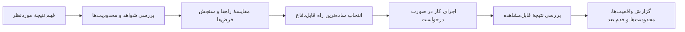

# ترمیناتور

### بازبینی مستند. تصمیم روشن. کارِ بررسی‌شده.

**ترمیناتور یک روند بازبینی تا تحویل برای عامل‌های هوش مصنوعی است.** با آن می‌توان محتوای سایت، UX اپ، تصمیم محصول، تحقیق یا کد را بررسی کرد؛ مشاهده را از قضاوت جدا نگه داشت؛ و تغییر درخواستی را تا بررسی‌هایی که عامل واقعاً می‌تواند انجام دهد پیش برد.

> پاسخ خوب فقط با اعتمادبه‌نفس ساخته نمی‌شود؛ به هدف روشن، شواهد مرتبط، قضاوت مستقل و بررسی صادقانه نیاز دارد.

[](https://agentskills.io/specification)
[](#امنیت-و-حریم-خصوصی)
[English](README.md) · [فارسی](README.fa.md)

> **انتشار عمومی:** `siavash00memar/terminator-reasoning-skill` با مجوز MIT.

---

## چرا ساخته شده؟

عامل‌های هوش مصنوعی می‌توانند پاسخ روانی تولید کنند، اما همچنان ممکن است یک فرض ضعیف را بپذیرند، تخمین را با واقعیت اشتباه بگیرند یا بدون بررسی بگویند تغییری کار می‌کند. تیم‌ها هم ناچار می‌شوند دستورهای بررسی و تصمیم‌گیری را در هر درخواست دوباره بنویسند.

ترمیناتور روش کار را یک‌بار بسته‌بندی می‌کند. کمک می‌کند نتیجه روشن کند چه چیزی بررسی شده، چه چیزی نامعلوم مانده، چرا یک راه انتخاب شده، چه تغییری انجام شده و کدام بررسی‌ها موفق بوده یا اصلاً اجرا نشده‌اند.

## چه کار می‌کند؟

- **هدف را از راهکار پیشنهادی جدا می‌کند.** بررسی می‌کند آیا راهکار واقعاً به نتیجهٔ موردنظر می‌رسد.
- **شواهد را از استنباط جدا نگه می‌دارد.** وقتی شواهد ناکافی، قدیمی یا غیرمستقیم‌اند، این محدودیت را بیان می‌کند.
- **دنبال مثال نقض معتبر می‌گردد.** فرض‌های مهم را می‌سنجد، بدون اینکه صرفاً برای منتقد به‌نظررسیدن ایراد بسازد.
- **با اندازهٔ کار متناسب می‌شود.** برای سؤال ساده پاسخ کوتاه می‌دهد و برای تحقیق، تصمیم، رفع اشکال و پیاده‌سازی از روند دقیق‌تری استفاده می‌کند.
- **به بازخورد کاربر واکنش نشان می‌دهد.** اگر کاربر پیشنهادی را رد کند، فرضی را اصلاح کند یا محدودیتی بیفزاید، نیاز را دوباره می‌سنجد و گزینهٔ متناسب‌تری پیشنهاد می‌کند؛ صرفاً از پیشنهاد اولش دفاع نمی‌کند.
- **کار را تا بررسی نتیجه پیش می‌برد.** وقتی تغییر خواسته شده، زمینه را می‌خواند، تغییر را انجام می‌دهد، بررسی‌های مرتبط و در دسترس را اجرا می‌کند و نتیجه را دقیق گزارش می‌دهد.
- **محدودیت‌هایش را روشن می‌گوید.** درستی را تضمین نمی‌کند، سوگیری را حذف نمی‌کند، مدل را تغییر نمی‌دهد، ابزار جدید فراهم نمی‌کند و دستورهای بالادستی را دور نمی‌زند.

## چرخهٔ کار



در هر سشن، **تحلیل سرد** به‌عنوان تگ پایه و با اجرای سبک فعال است. برای هر درخواست معنادار، اسکیل یک دور کامل روی نقشهٔ محرک‌های ۲۸ تگ می‌زند تا تگ مرتبط جا نیفتد؛ این کار سهمیه ایجاد نمی‌کند و کار ساده می‌تواند فقط با تگ پایه انجام شود. هر تگ تخصصی باید روش مشخصی را واقعاً اعمال کند. تگ‌های فعال با آیکن اختصاصی در یک خط کوچک و جدا از پاسخ نمایش داده می‌شوند و برای کار معنادار، خلاصهٔ کوتاهی از روش اجراشده هم می‌آید. تگ‌ها نام روش کارند، نه حالت ویژهٔ مدل؛ قابلیت جدیدی فعال نمی‌کنند. جزئیات در [شیوه‌نامهٔ اجرایی ۲۸ تگ](docs/tag-protocols.fa.md) آمده است.

## چه زمانی استفاده شود؟

وقتی کار ابهام، بده‌بستان، پیامد یا پیاده‌سازی واقعی دارد:

| نوع کار | چه چیزی اضافه می‌کند |
|---|---|
| انتخاب بین چند راه | معیارهای روشن، مقایسهٔ منصفانه و پیشنهاد مشخص |
| تحقیق یا سؤال واقعی | بررسی کیفیت و تازگی منبع، شکاف شواهد و نتیجه‌گیری با احتیاط مناسب |
| بررسی محتوای سایت | مخاطب و هدف صفحه، پشتوانهٔ ادعاها، ترتیب پیام‌ها، خوانایی و دعوت به اقدام |
| ارزیابی UX اپ یا سایت | مسیر انجام کار، واکنش‌گرایی و دسترس‌پذیری، اصطکاک‌های اولویت‌دار و تفکیک نوع شواهد |
| رفع اشکال | بازتولید، جداسازی علت، اصلاح متمرکز و بررسی بازگشت مشکل |
| نقد محصول یا تجربهٔ کاربری | ارزیابی بر اساس هدف کاربر، دسترس‌پذیری، نمایش واکنش‌گرا و شواهد موجود |
| تحویل کد یا طراحی | بررسی زمینه، پیاده‌سازی، کنترل‌های مرتبط و گزارش صادقانه |
| ادعای حساس یا نامطمئن | بیان مجهولات، سناریوهای نامطلوب و شواهد لازم برای تصمیم |

برای پاسخ تک‌مرحله‌ای یا تغییر خیلی ساده، خود اسکیل می‌گوید سبک بماند. قرار نیست هر گفت‌وگویی به ممیزی تبدیل شود.

در [الگوهای آمادهٔ بازبینی](references/review-recipes.md) نمونه‌های شروع برای محتوای سایت و UX اپ آمده است: چه چیزی بررسی شود، چطور مشاهدهٔ واقعی از ریسک احتمالی جدا بماند و گزارش نهایی چه داشته باشد. این الگوها ادعای انجام تست کاربر یا تحلیل داده‌هایی را که ارائه نشده‌اند نمی‌کنند.

### چه کسانی بیشترین فایده را می‌برند؟

- **تیم‌های محصول و محتوا** برای بازبینی صفحهٔ فرود، متن محصول، شروع کار و مسیرهای اپ با کمک هوش مصنوعی.
- **طراحان و توسعه‌دهندگان** که یافته‌های UX اولویت‌دار و متکی به صفحهٔ قابل‌مشاهده می‌خواهند و می‌خواهند اصلاحش را هم بررسی کنند.
- **سازندگان مستقل و مشاوران** که می‌خواهند معیارهای بازبینی را بین پروژه‌ها تکرار کنند، بدون اینکه هر بار یک دستور طولانی بنویسند.

برای کارهایی به‌کارش ببر که ابهام، ارزیابی، بده‌بستان، پیامد یا پیاده‌سازی مهم دارند. برای تغییر یک‌مرحله‌ای ساده، روند را سبک نگه دار. در کار تخصصی، آن را کنار اسکیل همان حوزه به‌عنوان لایهٔ کنترل کیفیت استفاده کن؛ جایگزین روش تخصصی یا بازبین واجد صلاحیت نیست.

## یک نمونهٔ سریع

**درخواست:** «متن صفحهٔ اصلی و مسیر ثبت‌نام در موبایل را بررسی کن. سه اصلاح مهم را بگو و متن را بازنویسی کن.»

**با ترمیناتور:** عامل صفحه، تصویر، کد یا آمار موجود را بررسی می‌کند؛ هدف صفحه، پشتوانهٔ ادعاها، ترتیب پیام و کارهای اصلی موبایل را می‌سنجد؛ ایراد مشاهده‌شده را از ریسک مبتنی بر اصول UX جدا می‌کند؛ سپس متن پیشنهادی و مواردی را که هنوز نیاز به آزمون کاربر دارند ارائه می‌دهد.

این نمونه روند موردنظر را توضیح می‌دهد، نه نتیجهٔ اندازه‌گیری‌شده را. هنوز افزایش اندازه‌گیری‌شده‌ای در موفقیت مدل‌ها یا کارها منتشر نشده است.

## نصب

این اسکیل شامل `SKILL.md`، نقشهٔ فعال‌سازی کامل، شیوه‌نامهٔ اجرایی ۲۸ تگ و راهنماهای تکمیلی متناسب با نوع کار است. وابستگی اجرایی یا اسکریپت قابل‌اجرا ندارد.

### Codex، Cursor و ابزارهایی که `~/.agents/skills` را می‌شناسند

بعد از انتشار، آن را در پوشهٔ اسکیل‌های کاربر کلون کن:

```bash
git clone https://github.com/siavash00memar/terminator-reasoning-skill.git \
  "$HOME/.agents/skills/terminator"
```

در Windows PowerShell:

```powershell
git clone https://github.com/siavash00memar/terminator-reasoning-skill.git `
  "$HOME\.agents\skills\terminator"
```

برای استفادهٔ فقط در یک پروژه، آن را در `<project>/.agents/skills/terminator` کلون کن. Codex و Cursor رسماً از این مسیر مشترک پشتیبانی می‌کنند. اگر Codex اسکیل را نشناخت، آن را دوباره اجرا کن و بعد `$terminator` را بنویس یا درخواست مرتبطی بده.

### Claude Code

```bash
git clone https://github.com/siavash00memar/terminator-reasoning-skill.git \
  "$HOME/.claude/skills/terminator"
```

برای استفادهٔ فقط در یک پروژه، مسیر `<project>/.claude/skills/terminator` را به‌کار ببر. می‌توانی `/terminator` را اجرا کنی یا یک درخواست مرتبط بنویسی تا خودکار فعال شود.

### Gemini CLI

```bash
gemini skills install https://github.com/siavash00memar/terminator-reasoning-skill.git --scope user
```

برای نصب در یک پروژه از `--scope workspace` استفاده کن. در Gemini CLI دستور `/skills list` فهرست را نشان می‌دهد؛ اگر لازم بود اسکیل‌ها را دوباره بارگذاری کن. برای جزئیات رضایت نصب و اعتماد به پوشه، مستندات رسمی را ببین.

### به‌روزرسانی یا حذف

روش‌های کلون مستقیم بالا یک کپی Git معمولی نصب می‌کنند. با `git -C <skill-folder> pull` به‌روزرسانی‌اش کن. برای حذف، فقط پوشهٔ نصب‌شدهٔ `terminator` را پاک کن. در Gemini CLI می‌توان از `gemini skills uninstall terminator --scope user` استفاده کرد؛ برای نصب پروژه‌ای، `workspace` را جایگزین کن.

جزئیات هر پلتفرم و مسیر OpenAI API در [راهنمای نصب](docs/installation.md) آمده است.

## چه هست و چه نیست؟

| هست | نیست |
|---|---|
| دستورالعمل تکرارپذیر و روشی متناسب با نوع کار | مدل، ابزار، عامل یا بنچمارک جدید |
| پوشه‌ای سازگار با قالب Agent Skills | تضمین رفتار یکسان در تمام ابزارهای سازگار |
| راهنمای بررسی شواهد و گزارش صادقانه | جایگزین تست، بازبینی منبع، تخصص دامنه یا تأیید کاربر |
| کمکی برای دیدن روشن‌تر بده‌بستان‌ها | اثبات بی‌سوگیری یا درستی پاسخ |

کیفیت نتیجه همچنان به مدل، ابزارها و مجوزهای موجود، زمینهٔ کار، کیفیت شواهد و پیروی کلاینت از دستورها بستگی دارد.

## امنیت و حریم خصوصی

ترمیناتور فعلاً **فقط دستورالعمل Markdown** دارد: کد اجراییِ همراه، وابستگی نرم‌افزاری، اعتبارنامه یا تله‌متری ندارد. راهنمای آن ممکن است استفاده از مرورگر یا ابزارهای موجود در عامل میزبان را پیشنهاد کند؛ خود بسته این قابلیت‌ها را فراهم یا محدود نمی‌کند. فایل‌ها را پیش از نصب بخوان. دستورهای اسکیل بالاتر از قواعد سیستمی، کنترل‌های ایمنی، سیاست مخزن یا الزام تأیید کاربر نیستند. جزئیات در [راهنمای امنیت](SECURITY.md) است.

## ارزیابی

این مخزن یک معیار امتیازدهی و سناریوهای مخالف‌خوان در [راهنمای ارزیابی](docs/evaluation.md) دارد: وضوح، برخورد با شواهد، تناسب اندازهٔ پاسخ، اجرا، بررسی نتیجه، سازگاری و امنیت. این‌ها مجموعهٔ ارزیابی دستی‌اند، نه بنچمارک منتشرشده؛ نتیجه با مدل و کلاینت تغییر می‌کند. امتیاز معیار به‌تنهایی اثبات برتری نیست.

## مشارکت

گزارش مفید شامل درخواست، زمینهٔ لازم، رفتار مورد انتظار، نتیجهٔ مشاهده‌شده و نام کلاینت و مدل (اگر معلوم است) می‌شود. اطلاعات محرمانهٔ پروژه یا اعتبارنامه‌ها را ارسال نکن. راهنمای [مشارکت](CONTRIBUTING.md) را ببین.

## منابع و سازگاری

راهنمای نصب در **۲۵ اکتبر ۲۰۲۶** با مستندات رسمی بررسی شده است. مسیرها و دستورهای نصب ممکن است تغییر کنند؛ پیش از اتکا به آن‌ها در نسخه‌ای جدید، مستندات لینک‌شده را دوباره بررسی کن.

- [مشخصات Agent Skills](https://agentskills.io/specification)
- [Codex: ساخت اسکیل](https://learn.chatgpt.com/docs/build-skills)
- [Claude: نمای کلی Agent Skills](https://platform.claude.com/docs/en/agents-and-tools/agent-skills/overview)
- [Gemini CLI: Agent Skills](https://geminicli.com/docs/cli/skills/)
- [Cursor: Agent Skills](https://cursor.com/docs/skills)
- [OpenAI API: Skills](https://developers.openai.com/api/docs/guides/tools-skills)

## مجوز

