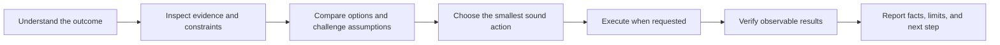

# Terminator

### Evidence-led reviews. Clear decisions. Work checked before handoff.

**Terminator is a reusable review-to-delivery workflow for AI agents.** Use it to examine website content, app UX, product decisions, research, or code; separate observed facts from judgment; and carry requested changes through to checks the agent can actually run.

> Better answers do not come from confidence alone. They come from clear goals, relevant evidence, independent judgment, and honest verification.

[](https://agentskills.io/specification)
[](#security-and-privacy)
[English](README.md) · [فارسی](README.fa.md)

> **Public release:** `siavash00memar/terminator-reasoning-skill`. Licensed under MIT.

---

## Why it exists

General-purpose agents can produce fluent answers while still accepting a weak premise, confusing an estimate with a fact, or claiming a change works without checking it. Teams also end up repeating the same decision and review instructions in every prompt.

Terminator packages a consistent working method once. It helps an agent make its reasoning auditable in the result: what it inspected, what remains uncertain, why it chose a solution, what it changed, and which checks passed or did not run.

## What it does

- **Separates the goal from the suggested solution.** It checks whether the requested approach actually serves the outcome.
- **Keeps evidence and inference distinct.** It calls out missing, stale, or indirect evidence when that affects the answer.
- **Looks for credible counterexamples.** It challenges consequential assumptions without inventing objections just to sound skeptical.
- **Adapts to the task.** It uses a compact answer for a simple question and a more deliberate workflow for research, decisions, debugging, and implementation.
- **Responds to feedback.** When you reject a proposal, correct an assumption, or add a constraint, it re-evaluates the need and offers the best fitting alternative instead of defending its first suggestion by default.
- **Carries work through to verification.** When asked to change something, it inspects the context, makes the change, runs relevant available checks, and reports the result accurately.
- **Names limits plainly.** It cannot guarantee correctness, eliminate bias, change a model, grant tools, or override higher-priority instructions.

## The working loop



Every session starts with **Cold Analysis** as a lightweight baseline. For each substantive turn, the skill scans the full 28-tag activation map so a less common but relevant method is not missed; this is a coverage check, not a quota. A task may use only the baseline when simple. Every specialist tag must correspond to a method actually applied. Active tags appear with assigned icons in a separate, small line, and substantive responses include a concise, user-visible method trace. Tags are working labels, not model modes; they do not unlock capabilities. See the [28-tag operational protocol](docs/tag-protocols.fa.md).

## When to use it

Use Terminator when the task has meaningful uncertainty, trade-offs, consequences, or implementation work:

| Task | What Terminator adds |
|---|---|
| Choosing between approaches | Criteria first, comparable options, and a clear recommendation |
| Research or factual questions | Source quality, recency, evidence gaps, and calibrated conclusions |
| Website content review | Audience and page goal, claim support, message hierarchy, readability, and calls to action |
| App or site UX audit | Task flow, responsive and accessibility checks, prioritized friction, and evidence labels |
| Debugging | Reproduction, root-cause isolation, a focused fix, and regression checks |
| Product or UX review | Criteria tied to user goals, accessibility, responsive behavior, and observed evidence |
| Code or design delivery | Inspection, implementation, relevant verification, and an honest handoff |
| High-stakes or uncertain claims | Explicit unknowns, adverse cases, and the evidence needed to decide |

For a one-step factual answer or a trivial change, the skill says to stay lightweight. It is not a reason to turn every conversation into an audit.

Copy-ready starting points for these reviews are in [Review recipes](references/review-recipes.md). They show what to inspect, how to distinguish observed behavior from heuristic concerns, and what a useful handoff should contain. They do not claim user testing or analytics that were not provided.

### Who gets the most value

- **Product and content teams** that review landing pages, product copy, onboarding, or app flows with AI.
- **Designers and developers** who want prioritized UX findings tied to visible screens and followed by a verifiable fix.
- **Independent builders and consultants** who want reusable review criteria across projects without repeating a long instruction prompt.

Use it as a quality layer for work with meaningful uncertainty, evaluation, trade-offs, consequences, or requested implementation. For a trivial one-step edit, keep it lightweight. For specialized work, pair it with the relevant domain skill; Terminator does not replace qualified reviewers or domain-specific methods.

## A quick example

**Prompt:** “Review our home page copy and mobile sign-up flow. Give me the three most important fixes and revise the copy.”

**With Terminator:** the agent inspects the available page, screenshots, source, or analytics; checks the page goal, claims, message hierarchy, and key mobile tasks; labels observed defects separately from heuristic risks; then proposes focused copy changes and says what still needs user testing.

This example describes the intended workflow, not a measured outcome. The skill has not been shown to improve a measured success rate across models or tasks.

## Install

The skill is a small folder: `SKILL.md` plus task-specific reference guides. It has no runtime dependencies or bundled executable scripts.

### Codex, Cursor, or another client that discovers `~/.agents/skills`

After publication, clone it directly to the user-level skills folder:

```bash
git clone https://github.com/siavash00memar/terminator-reasoning-skill.git \
  "$HOME/.agents/skills/terminator"
```

On Windows PowerShell:

```powershell
git clone https://github.com/siavash00memar/terminator-reasoning-skill.git `
  "$HOME\.agents\skills\terminator"
```

For project-only use, clone into `<project>/.agents/skills/terminator` instead. Codex and Cursor officially support this shared directory. If Codex does not discover the skill, restart it; then invoke it with `$terminator` or ask a relevant task naturally.

### Claude Code

```bash
git clone https://github.com/siavash00memar/terminator-reasoning-skill.git \
  "$HOME/.claude/skills/terminator"
```

For project-only use, clone to `<project>/.claude/skills/terminator`. Claude Code can use `/terminator` or activate a matching skill automatically.

### Gemini CLI

```bash
gemini skills install https://github.com/siavash00memar/terminator-reasoning-skill.git --scope user
```

Use `--scope workspace` for a project-level install. In a Gemini CLI session, run `/skills list`; reload skills if needed. Check the official CLI documentation for consent and trust behavior.

### Update or remove

The direct-clone methods above install a normal Git checkout. Update it with `git -C <skill-folder> pull`. To remove it, delete only the installed `terminator` skill folder. Gemini CLI users can use `gemini skills uninstall terminator --scope user` (or `workspace` for a project install).

More platform notes and the OpenAI API path are in [Installation](docs/installation.md).

## What it is—and is not

| It is | It is not |
|---|---|
| Reusable instructions and a task-adaptive workflow | A new AI model, tool, agent, or benchmark |
| A portable Agent Skills folder | A guarantee that every compatible client behaves identically |
| A prompt for evidence checks and honest reporting | A substitute for tests, source review, domain expertise, or user approval |
| A way to make trade-offs easier to inspect | Proof that an answer is unbiased or correct |

The quality of results still depends on the model, the tools and permissions it has, the task context, the quality of available evidence, and whether the client follows the skill instructions.

## Security and privacy

Terminator currently contains **Markdown instructions only**: no bundled executable code, dependencies, credentials, or telemetry. Its guidance may recommend browsing or using tools already available to the host agent; the package itself does not provide or restrict those capabilities. Review the files before installing. Instructions do not override system rules, safety controls, repository policy, or your approval requirements. See [Security](SECURITY.md).

## Evaluation

The repository includes a rubric and adversarial scenarios in [Evaluation](docs/evaluation.md). They check clarity, evidence handling, proportionality, execution, verification, compatibility, and security. They are a manual evaluation set, not a published benchmark; results vary by client and model. Do not treat the rubric as proof of superior outcomes.

## Contributing

Useful reports include the task prompt, relevant context, the expected behavior, the observed behavior, and the client/model if known. Do not include private project data or credentials. See [Contributing](CONTRIBUTING.md).

## Sources and compatibility

The installation guide was checked against official documentation on **25 October 2026**. Client paths and commands can change; recheck the linked documentation before relying on a command in a new release.

- [Agent Skills specification](https://agentskills.io/specification)
- [Codex: build skills](https://learn.chatgpt.com/docs/build-skills)
- [Claude: Agent Skills overview](https://platform.claude.com/docs/en/agents-and-tools/agent-skills/overview)
- [Gemini CLI: Agent Skills](https://geminicli.com/docs/cli/skills/)
- [Cursor: Agent Skills](https://cursor.com/docs/skills)
- [OpenAI API: Skills](https://developers.openai.com/api/docs/guides/tools-skills)

## License

Licensed under the MIT License; see [`LICENSE`](LICENSE).
